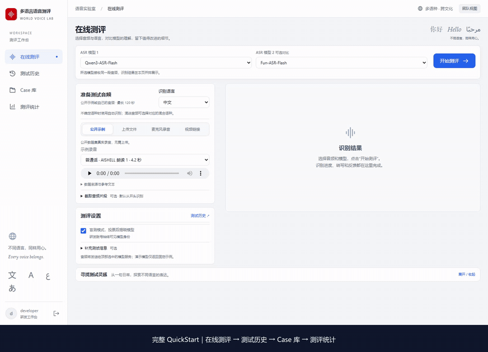
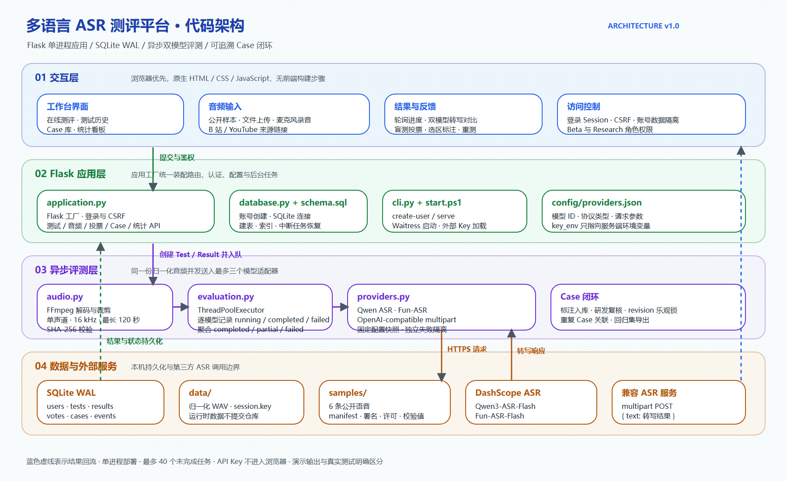

# 多语言 ASR 测评平台

> 面向真实语音识别体验、双模型对比和问题闭环的 Flask 工作台。

[](https://www.python.org/)
[](https://flask.palletsprojects.com/)
[](https://www.sqlite.org/)
[](https://ffmpeg.org/)

[操作演示](#完整操作演示约-90-秒) · [核心能力](#核心能力) · [代码架构](#代码架构) ·
[快速开始](#快速开始) · [默认登录账号](#默认登录账号) ·
[配置说明](#配置说明) · [开发与检查](#开发与检查) ·
[部署与数据](#部署与数据)

---

## 完整操作演示（约 90 秒）

从公开示例与双模型识别出发，依次完成历史回看、反馈提交、Case 复核和统计查看。

[](docs/media/QuickStart.mp4)

**[播放 / 下载 QuickStart.mp4](docs/media/QuickStart.mp4)** · [查看 GIF](docs/media/QuickStart.gif)

| 视频位置 | 内容                                              |
| -------- | ------------------------------------------------- |
| 00:00    | 在线测评：选择公开录音、双模型识别、同页对比      |
| 00:15    | 测试历史：按语种、状态和 ID 筛选，打开详情        |
| 00:33    | 提交反馈：选择类型、补充参考文本，提交到 Case 库  |
| 00:51    | Case 库：筛选、分派负责人、保存复核、展开处理记录 |
| 01:14    | 测评统计：测试计数、语种覆盖、问题分布与投票汇总  |

约 87 秒，带中文步骤字幕，无声；MP4 内置章节。在线识别来自真实 Qwen / Fun-ASR 调用，其余操作在当前数据的隔离副本中录制。演示反馈明确标注并复核为“无效”，未加入正式回归集，也未修改正式数据库的 Case、投票或统计。视频从登录后开始，不包含密码或密钥，部分停顿已剪去或加速。

## 项目简介

多语言 ASR 测评平台用于比较真实音频在不同语音识别模型上的表现。用户可以选择公开样本、上传文件、录制麦克风或保存视频来源，在同一页面查看多模型识别进度、对比转写结果、完成盲测投票，并针对错误片段提交分类标注。

研发人员可以复核 Case、填写归因和负责人、关联重复问题，并把确认后的真实测试纳入可导出的回归集。平台首版采用 Flask、SQLite WAL、本地音频目录和原生 JavaScript，不需要前端构建步骤。

| 维度 | 当前实现                                                        |
| ---- | --------------------------------------------------------------- |
| 前端 | Jinja 模板、原生 HTML / CSS / JavaScript                        |
| 后端 | Python 3.12+、Flask、Waitress                                   |
| 任务 | `ThreadPoolExecutor` 后台异步执行，最多同时排队 40 个未完成任务 |
| 存储 | SQLite WAL、随机文件名 WAV、本地 `data/`                        |
| 音频 | FFmpeg 统一裁剪为单声道 16 kHz WAV，单段最长 120 秒             |
| 模型 | Qwen3-ASR-Flash、Fun-ASR-Flash、OpenAI-compatible multipart     |
| 权限 | Beta 用户数据隔离；Research 用户可查看团队数据并维护 Case       |

## 近期进展

- **2026-11-07**：拆分为应用、数据库、音频、任务执行和模型适配模块；补充 Ruff、Prettier 和自动化回归检查。
- **2026-11-07**：支持 Qwen3-ASR-Flash 与 Fun-ASR-Flash 双模型同音频对比，单家失败时保留另一家结果。
- **2026-11-06**：完成登录、账号隔离、盲测投票、Case 复核、重测和回归集导出流程。
- **2026-11-06**：内置 6 条公开数据集语音，覆盖普通话、英语、日语和马来语。

## 核心能力

- **真实音频入口**：公开示例、音视频上传、麦克风录音、B 站 / YouTube 来源链接。
- **公平对比**：同一份归一化 WAV 同时送入 1–3 个模型，各模型独立记录状态、耗时和错误。
- **盲测流程**：Beta 用户先比较内容，再投票揭晓模型；Research 用户始终可查看模型身份。
- **问题标注**：按错字、漏识别、多识别、语种错误、数字时间、人名地名等类型提交 Case。
- **研发闭环**：复核状态、根因、负责人、重复问题关联、参考文本确认和正式回归集导出。
- **历史可追溯**：保留音频哈希、原始时间范围、模型配置快照、识别结果、用户反馈和审计记录。
- **轻量部署**：无前端构建、无外部 CDN、单进程运行，配置和密钥不进入浏览器。

## 代码架构



架构图的 Excalidraw 可编辑源文件位于
[docs/architecture-diagram.excalidraw](docs/architecture-diagram.excalidraw)，可在
[excalidraw.com](https://excalidraw.com/) 直接打开和修改。

### 分层职责

| 层          | 关键文件                                      | 职责                                              |
| ----------- | --------------------------------------------- | ------------------------------------------------- |
| 交互层      | `asr_eval/templates/`、`asr_eval/static/`     | 登录页、工作台、轮询、录音、结果对比、投票和标注  |
| HTTP 应用层 | `asr_eval/application.py`                     | Flask 工厂、Session / CSRF、角色权限、REST 路由   |
| 命令与启动  | `app.py`、`asr_eval/cli.py`、`start.ps1`      | 兼容入口、账号创建、Waitress 启动、外部密钥加载   |
| 音频处理    | `asr_eval/audio.py`                           | FFmpeg 解码、裁剪、单声道 16 kHz 归一化和 SHA-256 |
| 任务执行    | `asr_eval/evaluation.py`                      | 多模型并行执行、独立结果状态、总体状态聚合        |
| 模型适配    | `asr_eval/providers.py`                       | Qwen、Fun-ASR 和 OpenAI-compatible 协议适配       |
| 数据访问    | `asr_eval/database.py`、`asr_eval/schema.sql` | SQLite 连接、建表、索引、账号和中断任务恢复       |
| 配置与样本  | `config/`、`samples/`                         | 模型配置模板、公开音频、来源和许可                |

### 核心数据流

```text
浏览器提交音频
  → Flask 鉴权与 CSRF 校验
  → FFmpeg 归一化并生成 SHA-256
  → 创建 Test / Result 记录
  → ThreadPoolExecutor 并发送入模型适配器
  → 持久化各模型文本、耗时和状态
  → 页面轮询结果
  → 投票 / 标注 / Case 复核 / 回归导出
```

系统采用**单进程**模型。任务池、SQLite 连接和内存状态属于当前应用实例；正式扩容到多实例时，应迁移到 PostgreSQL、共享对象存储和独立任务 Worker。

## 快速开始

### 1. 环境要求

需要 **Python 3.12+** 和 **FFmpeg**。Node.js 只用于维护前端测试和格式化，不是运行依赖。

```powershell
python --version
ffmpeg -version
```

Windows 尚未安装 FFmpeg 时，可以运行：

```powershell
winget install Gyan.FFmpeg
```

安装后重新打开终端，确保 `ffmpeg -version` 可用。

### 2. 创建虚拟环境

在项目根目录执行：

```powershell
python -m venv .venv
.venv\Scripts\python -m pip install -r requirements.txt
```

开发或运行测试时安装开发依赖：

```powershell
.venv\Scripts\python -m pip install -r requirements-dev.txt
npm ci
```

### 3. 配置真实模型

首次运行复制配置模板；已有 `config/providers.json` 时保留现有配置：

```powershell
if (-not (Test-Path config/providers.json)) {
    Copy-Item config/providers.example.json config/providers.json
}
```

默认示例包含两个真实模型：

| 显示名称        | 模型 ID                    | 适配类型   |
| --------------- | -------------------------- | ---------- |
| Qwen3-ASR-Flash | `qwen3-asr-flash`          | `qwen_asr` |
| Fun-ASR-Flash   | `fun-asr-flash-2026-06-15` | `fun_asr`  |

二者默认读取同一个服务端环境变量：

```powershell
$env:DASHSCOPE_API_KEY = "你的百炼 API Key"
```

密钥只保存在服务器进程环境或项目外的密钥文件中，不会写入
`config/providers.json`，也不会返回浏览器。

### 4. 创建登录账号

当前 `data/platform.sqlite` 已包含默认演示账号，可先直接跳到
[默认登录账号](#默认登录账号)。仅在全新数据目录或其他部署环境需要执行：

```powershell
.venv\Scripts\python -m asr_eval create-user --username developer --role research
.venv\Scripts\python -m asr_eval create-user --username beta01 --role beta
```

命令会交互式读取密码，终端不回显。密码至少 10 位，同名账号不能重复创建。

### 5. 启动服务

推荐使用单进程 Waitress：

```powershell
powershell -NoProfile -ExecutionPolicy Bypass -File .\start.ps1
```

脚本会读取当前进程中的 Key，并尝试从项目上两级目录的
`.env\.env.dashscope` 加载 `DASHSCOPE_API_KEY` 或
`API_LOGGER_API_KEY`。也可以显式指定密钥文件：

```powershell
powershell -NoProfile -ExecutionPolicy Bypass -File .\start.ps1 -EnvFile D:\path\to\keys.env
```

打开 **http://127.0.0.1:5080**。前台运行时使用 `Ctrl+C` 停止服务。

开发时也可以直接运行 Flask；这种方式只读取环境变量，不自动加载密钥文件：

```powershell
.venv\Scripts\python -m asr_eval serve
```

未找到 `config/providers.json` 时，应用会回退到两个明确标识的固定文本演示模型。演示输出只用于验证产品流程，不代表真实识别结果。

Linux / macOS 使用：

```bash
python3 -m venv .venv
.venv/bin/python -m pip install -r requirements.txt
export DASHSCOPE_API_KEY="你的百炼 API Key"
.venv/bin/python -m waitress --call --listen=127.0.0.1:5080 --threads=12 asr_eval:create_app
```

## 默认登录账号

当前本地演示实例使用以下账号，可直接登录并访问
**http://127.0.0.1:5080/#stats** 查看测评统计：

| 项目     | 默认值                                            |
| -------- | ------------------------------------------------- |
| 登录地址 | `http://127.0.0.1:5080/login`                     |
| 账号     | `developer`                                       |
| 密码     | `ASR-demo-2026!`                                  |
| 角色     | `research`                                        |
| 权限     | 可查看团队统计、测试历史、Case 库并导出正式回归集 |

> **安全提示**：该密码仅用于本机开发或受控内网演示。公开部署、邀请外部用户或处理真实业务音频前，必须重新创建账号并更换密码。

新建其他研发账号：

```powershell
.venv\Scripts\python -m asr_eval create-user --username your-name --role research
```

新建 Beta 测试账号：

```powershell
.venv\Scripts\python -m asr_eval create-user --username beta01 --role beta
```

命令会交互式读取密码，终端不回显。密码至少 10 位，同名账号不能重复创建。项目代码本身不会自动创建共享账号；上面的 `developer` 是当前本地 `data/platform.sqlite` 中已配置的演示账号。

角色权限如下：

| 角色       | 权限                                                |
| ---------- | --------------------------------------------------- |
| `beta`     | 访问个人测试、音频、结果、投票和反馈                |
| `research` | 查看团队数据，复核和分派 Case，维护并导出正式回归集 |

## 使用流程

1. 选择公开示例，或切换到文件上传、麦克风录音、视频链接。选择示例会自动填入语种，也可以手动修改。
2. 在顶部选择“ASR 模型 1 / ASR 模型 2”，点击“开始测评”。第二项选择“不对比”即可单模型测评。
3. 在本页结果区查看识别进度与转写。所有模型接收完全相同的单声道 16 kHz WAV，并分别产生 API 用量。
4. Beta 用户可以先盲测投票再揭晓模型；Research 用户始终可见模型身份。
5. 选中有问题的文字并标注。研发复核后，真实测试和确认参考文本才可进入正式回归集。

提交不会跳转或清空表单。重测会创建关联的新记录，使用当前模型配置，原记录和原输出保持不变。

### 公开示例与来源

项目内置 AISHELL-1 普通话 2 条、LibriSpeech 英语 2 条、FLEURS 日语和马来语各 1 条，时长约 4–11 秒。登录后无需访问数据集网站即可试听。

[samples/README.md](samples/README.md) 和
[samples/manifest.json](samples/manifest.json) 保存署名、许可、原始 ID、参考文本和校验值。分发项目时须保留这些文件及样本许可证。

数据集参考文本不会发送给 ASR 模型，也不会自动成为研发确认的标注；截取音频时仍显示原始全文。这些示例只用于体验，不构成完整基准测评。

### 录音与视频链接

- 麦克风录音需要 localhost 或 HTTPS 以及浏览器权限；停止录音后上传整段文件，最长支持 120 秒片段。
- B 站 / YouTube 链接用于保留来源和时间范围；需要补传有权使用的同源音视频文件。
- 未补传的链接保存为“待补充音频”，可在结果区继续补传。
- 平台不会自动下载视频，也不会把字幕当作 ASR 结果。

## 项目结构

```text
asr_eval/
├── app.py                          # 兼容 CLI / Waitress 入口
├── start.ps1                       # Windows 启动与外部密钥加载
├── asr_eval/                       # Python 应用包
│   ├── application.py              # Flask 工厂、认证与 HTTP 路由
│   ├── audio.py                    # FFmpeg 裁剪与音频归一化
│   ├── database.py                 # SQLite、账号与数据库初始化
│   ├── schema.sql                  # 数据表与索引
│   ├── evaluation.py               # 多模型并行任务与状态持久化
│   ├── providers.py                # Qwen / Fun-ASR / multipart 适配器
│   ├── constants.py                # 语种及问题分类词表
│   ├── cli.py                      # 账号管理与开发服务器命令
│   ├── templates/                  # Jinja 页面
│   └── static/                     # JavaScript、CSS、SVG
├── config/                         # 模型配置及模板
├── samples/                        # 公开录音、来源记录及许可
├── tests/                          # Python 与前端交互回归测试
├── docs/                           # 规格、验证记录与架构图
└── data/                           # 本机运行数据，不纳入版本控制
    ├── platform.sqlite             # 账号、测试、投票和 Case
    ├── session.key                 # 登录会话签名密钥
    ├── *.wav                       # 用户测试音频片段
    ├── logs/                       # 本机后台启动日志
    └── backups/                    # 整理前的源码及数据库备份
```

`data/logs/` 供本机后台启动使用；前台 `start.ps1` 的日志直接输出到终端。源码、配置模板和公开样本可纳入版本控制；`config/providers.json`、用户数据、密钥、虚拟环境和缓存均已忽略。

## 配置说明

| 环境变量            | 默认值 / 作用                                       |
| ------------------- | --------------------------------------------------- |
| `DASHSCOPE_API_KEY` | Qwen 与 Fun-ASR 的服务端 API Key                    |
| `ASR_PROVIDERS`     | 配置文件路径，默认 `config/providers.json`          |
| `ASR_DATA_DIR`      | 持久化目录，默认项目根目录下的 `data/`              |
| `ASR_HTTPS`         | 设置为 `1` 后启用安全会话 Cookie，仅用于 HTTPS 访问 |

配置在服务器启动时读取，修改后需要重启。配置模板使用北京地域域名；其他地域需要同时调整接口地址与对应地域 Key，业务空间专属域名也应按照供应商文档填写。

### 接入其他 ASR 服务

使用
[multipart 配置模板](config/providers.multipart.example.json)
中的条目扩展 `config/providers.json`。每个模型需要唯一的 `id`，以及
`name`、`kind`、`url`、`model`、`key_env` 和可选 `params`。

| `kind`              | 请求 / 响应协议                                                                                  |
| ------------------- | ------------------------------------------------------------------------------------------------ |
| `qwen_asr`          | Chat Completions 音频 Data URI；读取 `choices[0].message.content`                                |
| `fun_asr`           | DashScope 多模态音频 Data URI；读取 `output.text`                                                |
| `openai_compatible` | multipart POST：`file`、`model`、`response_format=json`、可选 `language`；返回 `{"text":"转写"}` |

Key 只放在 `key_env` 指定的服务器环境变量中。自动语种和混合语种不会强行发送单语提示。专有协议可在 `asr_eval/providers.py` 中增加适配。

## 开发与检查

运行检查：

```powershell
.venv\Scripts\python -m ruff check .
.venv\Scripts\python -m ruff format --check .
.venv\Scripts\python -m pytest -q --basetemp=.test-tmp
npm test
npm run format:check
```

统一格式化：

```powershell
.venv\Scripts\python -m ruff format .
npm run format
```

Python 使用 Ruff、4 空格与 88 字符行宽；前端使用 Prettier。格式化不会处理本机模型配置、用户数据或公开样本许可证。测试默认使用临时 SQLite、临时音频和模拟供应商，不消耗真实 API 用量。

前端回归通过模拟 DOM、网络和计时器运行实际页面处理函数，覆盖同页提交、轮询、投票、标注、重测、补传和页面切换竞态，但不能替代实际浏览器验收。

## 部署与数据

- 采用**单进程**部署：任务池和 SQLite 连接属于当前实例，不能直接启动多个独立 Worker。
- 多人访问时，在 Waitress 前配置 HTTPS 反向代理。启用 HTTPS 后，在启动前设置 `$env:ASR_HTTPS = "1"`。
- 当前默认监听 `127.0.0.1:5080`；公开部署前应配置入口认证、限流和持久化磁盘。
- 停止服务后整体备份 `data/`，并单独保管本机配置和项目外的密钥文件。不要只复制正在写入的 SQLite 主文件。
- 数据库初始化会兼容增加 `sample_id` 字段；进程中断的未完成任务会在下次正常启动时标记为失败或部分完成，用户可重测。

当前展示的耗时是 API 调用耗时，不代表流式首字或端点延迟。测试列表尚未实现分页，正式大规模使用前需要补充容量治理。

## 当前边界

| 项目       | 当前说明                                                        |
| ---------- | --------------------------------------------------------------- |
| 指标体系   | 已实现人工对比、投票和 Case 分类；尚未计算 WER / CER 和流式延迟 |
| 视频链接   | 保存来源、时间范围和待补传状态；不自动下载第三方视频            |
| 并发部署   | 单进程、SQLite 和本地点任务池；不适合直接横向扩容               |
| 登录体系   | 本地账号、密码哈希、Session / CSRF；尚未接入企业 SSO            |
| 浏览器验收 | 自动化覆盖页面逻辑；实际麦克风和不同分辨率仍需手动验收          |

## 项目文档

- [需求规格](docs/SPEC.md)
- [历史开发计划](docs/IMPLEMENTATION_PLAN.md)
- [验证与整理记录](docs/VERIFICATION.md)
- [代码架构图](docs/architecture-diagram.jpeg)
- [架构图 Excalidraw 源文件](docs/architecture-diagram.excalidraw)
- [原始产品方案](docs/多语言ASR测评平台_解决方案与开发Story.md)
- [公开样本署名及许可](samples/README.md)
- [贡献指南](AGENTS.md)
