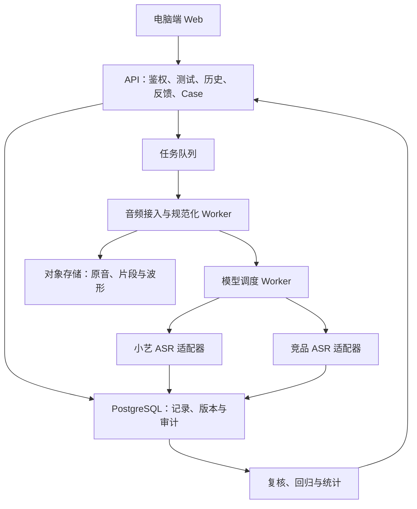

# 多语言 ASR 自由测评与真实 Case 收集平台

解决方案与开发 Story · V1.0 · 2026-11-06

文档用途：用于产品评审、研发任务拆分、接口设计和首版验收。本文是目标方案，不代表功能已经实现。技术选型和容量参数为建议默认值，可在开发评审中调整。

## 1. 背景与交付目标

多语言 ASR 的离线评测难以充分覆盖真实用户的口音、混语、人名地名、数字时间和复杂声音环境。研发与几十位 Beta 用户需要一个电脑端平台，随时选择真实音频，比较小艺与竞品的识别结果，留下问题并追踪修复。

平台定位为“多语言 ASR 自由测评与真实 Case 收集平台”。核心交付是一条完整链路：**自由测试 → 自动保存历史 → 分类标注 → 研发复核 → Case 沉淀 → 新版重测与回归验证**。

首版成功的标志：一位 Beta 用户完成一段马英混说音频的测试，稍后从历史记录补充“数字时间错误”标注；研发能够直接复听同一音频、确认问题、分派负责人，并用新版验证修复。

### 1.1 已明确的需求

| 项目 | 需求 |
|---|---|
| 使用终端 | 电脑浏览器；首版不提供手机录音入口 |
| 测试来源 | 电脑麦克风、本地文件、指定 B 站或 YouTube 视频链接 |
| 测试方式 | 单模型测试、同一音频多模型明测、A/B 盲测 |
| 使用对象 | 研发与几十位 Beta 用户，可持续反复测试 |
| 历史记录 | 每次提交自动保存，随时复听、查结果、补标注、重测 |
| 分类标注 | 多维标签、错误片段、可选正确文本；研发可复核 |
| 研发收益 | 可复现的真实 Case、问题分类统计、回归集与修复验证 |

### 1.2 首版范围与后续增强

| 优先级 | 交付内容 |
|---|---|
| P0 | 登录与角色权限、三类音频入口及链接降级、异步单模型/多模型测试、明测/盲测、历史、标注、Case 库、复核与重测、基础统计、可追溯导出 |
| P1 | 有人工参考文本的 WER/CER、槽位准确率、回归批量运行、批量导入、按词定位、自动转写差异对齐 |
| P2 | 原生流式竞品测试、端点与修订过程回放、相似问题自动聚合、失败挖掘和数据管线对接 |

首版采用异步整段识别。电脑麦克风录制后再送测；流式首字延迟、插话和端点能力不由首版整段测试推断。

## 2. 用户角色与权限

| 能力 | Beta 用户 | 研发 | 管理员 |
|---|---|---|---|
| 创建测试、查看结果 | 自己的测试 | 团队内测试 | 团队内测试 |
| 历史查看与检索 | 仅自己 | 同团队全部 | 同团队全部 |
| 新建或修改用户标注 | 自己的标注，修改留版本 | 可追加复核意见，保留原文 | 同研发 |
| 查看 Case 进度 | 与本人反馈关联的摘要 | 团队内完整内容 | 团队内完整内容 |
| 复核、分类、分派、关闭 Case | 无 | 有 | 有 |
| 管理模型、密钥、标签和用户 | 无 | 仅使用获授权模型 | 有 |
| 导出原音和团队数据 | 无 | 按团队授权 | 有 |

所有查询、音频访问、导出和修改操作均在服务端校验团队与归属。前端隐藏按钮不能替代权限校验。Case 摘要不向 Beta 用户暴露其他反馈者身份或音频。

## 3. 用户路径与页面规格

导航：在线测评、测试历史、Case 库、测评统计；模型与用户配置仅管理员可见。Beta 用户默认落在在线测评页，研发可进入团队历史或待复核 Case。

### 3.1 在线测评页

桌面布局：上方音频输入与播放器，中下方模型结果并排，右侧标注抽屉。建议最小支持宽度 1280px；较窄窗口改为结果页签。

| 区域 | 内容与交互 |
|---|---|
| 音频来源 | “电脑录音 / 上传文件 / 视频链接”三页签，另有“使用示例” |
| 录音 | 开始、停止、试听、重新录制；麦克风拒绝或不可用时给出原因与上传入口 |
| 文件 | 支持 WAV、MP3、M4A、FLAC、WebM；校验真实格式、大小、时长，不能只检查后缀 |
| 视频链接 | 粘贴地址，解析来源和可取得的元信息，填写起止时间；明确显示“可送测 / 需补传原音 / 解析失败” |
| 选段与复听 | 时间输入与可拖选区间、播放/暂停、循环；波形可由后台生成，缺失时仍可用时间选段 |
| 模型设置 | Beta 使用研发配置的模型组合；可选仅测小艺；研发可选择版本、模式和支持的参数 |
| 语种设置 | 自动识别或人工指定；混说可选择多个语言提示，记录各模型实际支持情况 |
| 结果 | P0 单模型或 2—3 列明测，盲测固定两列 A/B；每列单独显示排队、识别中、完成、失败 |
| 标注抽屉 | 关联模型结果，选择片段与问题类型；正确文本、场景、声音条件均可选 |

建议默认限制：单次送测片段不超过 120 秒；本地源文件不超过 200 MB、30 分钟；长文件需先选短片段。限制均由后台配置并在输入前提示。

提交后先创建测试记录，再异步处理。用户可离开页面；刷新或从历史进入能够恢复任务状态。提交按钮禁用与幂等键共同防止重复任务。

**链接处理约定：** 先提供团队允许的链接和授权素材映射。能取得原音时生成固定片段后送测；只有播放器或字幕时，保存链接、选段与待补传状态，用户补传原文件后继续。原音提取能力由独立接入器实现，不承诺任意公开视频均可下载，也不以字幕冒充 ASR 结果。

### 3.2 明测与盲测

明测展示具体服务、模型标识、版本、模式和参数生效情况。盲测在创建时由服务端随机固定 A/B 映射，提交投票前不通过接口、错误信息、音频路径或导出泄露身份。

投票项：A 更准、B 更准、都准确、都有问题、听不清跳过。每个用户对每个测试仅保留一张有效票；未揭晓前允许修改并保留审计记录。揭晓后冻结原始盲测票，后续更改只作为补充意见，不改变盲测统计。两家都成功且用户已试听才允许偏好投票；部分失败只可提交服务问题反馈，不计入识别偏好统计。

盲测偏好票与具体错误标注相互独立。用户可以只投票，也可以只标错。差异高亮首版可按文本比较实现，不能将文本差异自动判断为识别错误。没有时间戳的结果只支持手动时间选段，不显示虚假的按词定位。

### 3.3 测试历史页

| 列表字段 | 定义 |
|---|---|
| 测试时间与测试 ID | 支持按时间倒序，便于引用与排障 |
| 音频标题、来源与片段时长 | 原始来源区间与片段时长同时可查 |
| 语种与语言特征 | 区分用户指定和模型检测 |
| 模型组合与测试状态 | 盲测未揭晓时仅显示匿名信息 |
| 标注摘要 | 标注数量、问题类型、关联 Case 状态 |
| 操作 | 查看、补充标注、重测 |

筛选：时间、语种、模型、来源、任务状态、是否标注、问题类型；研发另可按测试者筛选。关键词检索标题、转写和修正文，支持分页与组合条件。

详情保留当时的音频、配置、原始结果、用户反馈和版本信息。“用最新版重测”生成新测试并关联 parent_test_id；原记录不被覆盖。失败服务的重试生成独立执行尝试，不修改已完成尝试的原始数据。

### 3.4 分类标注

| 维度 | 首版分类 | 规则 |
|---|---|---|
| 问题类型 | 错字、漏识别、多识别、语种错误、数字时间、人名地名、标点格式、断句、服务响应慢、服务异常、不确定 | 必选一个或多个 |
| 语言特征 | 单语、混说、方言、口音、未知 | 多选；不强制用户判断 |
| 场景 | 小艺指令、输入法口述、会议、访谈、视频内容、其他、未知 | 可选 |
| 声音条件 | 安静、噪声、背景音乐、远场、多人重叠、未知 | 多选 |
| 影响程度 | 轻微影响阅读、改变原意、导致任务失败、不确定 | 可选 |
| 研发归因 | 声学识别、语种判断、ITN、端点、服务异常、待定位 | 研发填写，与用户分类分开 |

标注最小提交项为问题类型，默认关联当前整段音频和指定模型结果；用户可进一步选片段、选文字、补充正确文本。不知道正确拼写也能提交。标签使用稳定 ID 与维度；停用标签仍可在历史查看，重命名保留变更记录。

音频定位统一使用片段内毫秒区间，满足 0 ≤ start_ms < end_ms ≤ duration_ms；同时保留源文件偏移。选中文本记录所属结果 ID、文本版本、字符区间及原文快照，不跨重测结果复用偏移。

### 3.5 Case 库与复核页

研发列表显示 Case ID、标题、语种、分类、影响程度、状态、负责人、反馈来源数、更新时间。详情首屏并排呈现原音、各模型原始输出、用户修正与研发确认文本。

支持确认问题、退回补充、关联已有 Case、人工合并、分派负责人、填写根因、加入回归集、指定新版验证和重新打开。合并仅建立关联，保留每条原始反馈、用户和测试记录。

Case 状态：待复核 → 已确认 → 处理中 → 待验证 → 已关闭；无效反馈可关闭并填写原因；新验证失败可回到处理中。关闭原因为已修复、非问题、重复、无法复现等，不能混成“全部修复”。重复 Case 记录目标 Case ID。进入待验证须有目标模型版本；以已修复关闭须关联成功的新测试与研发验证结论。

### 3.6 测评统计页

P0 展示测试数、有效音频时长、语种覆盖、来源分布、标注数、已确认 Case 数、分类分布及修复验证情况。区分个人范围与团队范围、测试总时长与按片段哈希去重时长。

盲测分开展示五类投票及有效样本量，按语种、模型组合与模型版本筛选；双方完成且投 A/B/都准确/都有问题的票为有效比较，跳过与服务失败单列。若展示 A 优胜比例，定义为 A 更准票数 ÷ 有效比较票数，同时展示全部分布。自由测试具有选样偏差，不作为整体语言准确率或行业排行榜。

## 4. 系统架构与任务链路

建议采用 Python FastAPI 后端、React + TypeScript 前端、PostgreSQL、Redis + Celery 异步任务与 S3 兼容对象存储；本地可用 MinIO。用 Docker Compose 提供首版启动方式。以上为推荐实现方案。

不需要首版拆为多个独立微服务。API 与 Worker 可分别扩容；不同模型采用独立并发配额，避免一个竞品超时阻塞其他模型。

处理顺序：接入素材 → 校验和选段 → 生成规范化片段及哈希 → 固化模型配置 → 并行调用模型 → 每家独立保存结果 → 更新任务聚合状态 → 接收反馈。素材一经用于测试便不覆盖。

统一基准片段建议为 16 kHz、单声道、PCM WAV，记录声道策略和处理版本。若模型接口要求其他编码，由适配器生成派生文件，并记录基准哈希、派生哈希和实际输入格式。首版不额外降噪或变速；所有模型比较同一有效内容和时间范围。

适配器契约包括：能力查询、参数校验、识别请求、状态查询或回调、结果解析、错误归一化。输出至少包含 text、detected_language、segments（可空）、provider_request_id、model_identifier、requested_config、effective_config、timing、error。厂商不披露精确修订号时，明确标注“服务未披露”，保留调用时间和返回元数据，不承诺完全复现其内部模型。

不支持的配置不得静默宣称生效。提交前提示，记录忽略或替代情况；不可比的配置在结果中标明。实际服务调用耗时与排队、素材处理耗时分别记录；首版不报告首字延迟。

### 4.1 状态与异常

| 对象 | 状态与规则 |
|---|---|
| 素材 | pending、resolving、needs_audio、processing、ready、failed |
| 测试 | queued、preparing、running、completed、partial_failed、failed、cancelled |
| 模型执行 | queued、running、succeeded、failed、timeout、cancelled |

completed 要求所有选定模型成功；partial_failed 表示至少一家成功且至少一家失败；全部失败为 failed。任务聚合仅在所有执行到达终态后完成。素材未 ready 时不可进入模型识别，needs_audio 可保存为草稿。

模型超时、限流和临时网络错误可有限重试，建议最多自动重试两次并指数退避；鉴权、非法参数不自动重试。每次尝试留记录。队列重复投递通过执行 ID 和状态锁防止重复入库，外部服务不能保证幂等时记录可能重复计费风险并限制重新派发。

Worker 崩溃由租约与超时扫描恢复；重试只针对失败模型。终态取消后忽略迟到回调对状态的覆盖，但保留审计。页面显示可行动的错误原因和重试入口。

## 5. 数据模型

| 实体 | 关键字段与关联 |
|---|---|
| User / Team | user_id、team_id、角色、状态 |
| AudioAsset | owner_id、team_id、source_type、source_url、原始对象路径、源哈希、格式、时长、接入状态 |
| AudioClip | asset_id、source_start_ms、source_end_ms、duration_ms、规范化对象路径、sha256、处理版本 |
| ModelVersion | provider、model_id、版本标签、模式、能力声明、启用状态、服务端密钥引用 |
| TestRun | creator_id、team_id、clip_id、mode、parent_test_id、配置快照、状态、idempotency_key |
| ModelExecution | test_id、model_version_id、requested/effective_config、attempt_no、状态、耗时、错误与请求 ID |
| TranscriptResult | execution_id、原始响应受控路径、text、segments、检测语种、结果哈希 |
| BlindAssignment / Vote | test_id、服务端 A/B 映射、揭晓时间、user_id、choice、投票版本 |
| Annotation / Revision | test_id、result_id、时间区间、文本区间、标签、修正文、备注、作者、修订号 |
| Case / CaseAnnotation | Case 状态、负责人、根因、确认文本；通过关联表聚合多条标注 |
| Verification | case_id、目标版本、验证 test_id、结论、复核人、时间 |
| RegressionSet / Item | 集合版本、clip_id、已确认参考文本、来源 Case、准入状态 |
| AuditEvent | 操作人、对象、动作、变更前后摘要、时间 |

约束：测试与模型结果不被重测覆盖；原始反馈与研发结论分表或分字段保存；一个测试可有多家结果和多条标注，一个 Case 可关联多条反馈；同一原音多个片段可复用文件存储，但不能据此扩展用户访问权限。

数据库时间使用 UTC，前端按用户时区展示并可查绝对时间。文本与 JSON 全链路 UTF-8；阿拉伯语等结果支持 RTL，模型列顺序与时间控件方向保持稳定。

## 6. API 规格草案

所有接口位于 /api/v1，使用会话认证，列表返回 items、next_cursor；状态查询支持短轮询，后续可增加 SSE。

| 方法与路径 | 作用与关键参数 |
|---|---|
| POST /assets/uploads | 创建上传意图，返回短时上传凭证和 asset_id |
| POST /assets/{id}/complete | 上传完成，后台校验格式与元信息 |
| POST /assets/links | 提交 URL 和起止时间，返回接入状态 |
| POST /assets/{id}/attach-audio | 为 needs_audio 素材补传源文件 |
| GET /assets/{id} | 查询处理状态与可用时长 |
| POST /clips | asset_id、起止毫秒，生成固定片段 |
| GET /models | 返回用户获授权的模型及能力 |
| POST /tests | clip_id、model_version_ids、mode、language_hints、config；请求头 Idempotency-Key |
| GET /tests | 归属自动约束，支持时间、语言、状态与分类筛选 |
| GET /tests/{id} | 任务状态、允许展示的模型信息、结果和反馈摘要 |
| POST /tests/{id}/reruns | 新建关联测试，指定新版配置 |
| POST /executions/{id}/retries | 失败执行的新尝试，仅获授权角色可用 |
| POST /tests/{id}/votes | 提交盲测投票并按规则揭晓 |
| POST /tests/{id}/annotations | 创建分类标注 |
| PATCH /annotations/{id} | 携带 revision，冲突返回 409，保存新修订 |
| GET /labels | 返回维度、稳定分类 ID 和启用状态 |
| GET /cases、GET /cases/{id} | 查询可见 Case 和复核详情 |
| POST /cases | 从一条或多条反馈建立 Case |
| POST /cases/{id}/transitions | 携带 expected_revision、目标状态与原因执行状态迁移 |
| POST /cases/{id}/merge | 关联目标 Case，保留来源与审计 |
| POST /cases/{id}/verifications | 关联新版测试和验证结论 |
| POST /regression-sets/{id}/items | 只接纳已确认原音与参考文本 |
| GET /statistics | 按权限、时间与语种聚合 |
| POST /exports | 创建受控导出任务；原音下载另校验权限 |

统一错误结构包含 code、message、request_id、retryable、details。常见错误：权限不足、素材待补充、格式不支持、区间非法、配置不支持、版本冲突、模型限流与超时。API 从已注册 ModelVersion 读取端点，不接受用户任意填入服务地址。

## 7. 开发 Story 与验收标准

### S01 · 登录与访问范围（P0）

**作为 Beta 用户，我希望登录后直接开始测试，并只看到自己的记录。**

- Given 两位不同 Beta 用户，When A 请求 B 的历史、原音、结果或标注接口，Then 服务端拒绝访问且不泄露对象内容。
- Given 研发账户，When 查看团队记录，Then 能查看同团队测试，不能访问其他团队。
- Given 未登录访问，When 请求受保护数据，Then 返回认证失败并引导登录。

### S02 · 电脑录音与文件上传（P0）

**作为测试者，我希望录音或上传文件，试听并选定一段送测。**

- 录音需 HTTPS 或 localhost，支持当前桌面 Chrome、Edge；拒绝麦克风授权后可改为上传。
- 合法文件上传完成后能试听、获取时长并选段；伪造后缀、超限或损坏文件有明确错误。
- 同一片段送给多个模型时可追溯到相同基准片段哈希；没有被默认降噪或变速。

### S03 · 视频链接取材与降级（P0）

**作为测试者，我希望粘贴指定 B 站或 YouTube 链接，选择一段真实音频测试。**

- 团队已接入授权素材的有效链接，可解析、裁剪、试听并送测。
- 无原音的链接保存为 needs_audio，保留 URL 与时间段，补传后继续；不创建伪成功转写。
- 非允许域名、非法 URL、过期素材与无效区间被明确拒绝或标明原因。
- 补传文件时须确认与视频时间轴的偏移关系，界面显示最终试听片段，避免截错句子。

### S04 · 同音频模型对比（P0）

**作为测试者，我希望一次提交就能看到多家模型的结果。**

- 一次任务并行请求选定模型，各自独立显示状态与结果。
- 一家超时、另一家成功，任务最终为 partial_failed，成功结果仍可查看和标注。
- 页面刷新、切换或服务重启后，已保存记录仍可恢复；失败重试不覆盖成功结果。
- 每家保存请求配置、实际生效配置、版本标识和耗时；模拟适配器显著标记为演示，不纳入真实对比统计。

### S05 · 盲测投票（P0）

**作为 Beta 用户，我希望先比较内容，再知道模型身份。**

- 同一任务重复打开，A/B 顺序一致；投票前所有面向该用户的接口均不泄露身份。
- 五种选择均可提交；部分模型失败时不开放识别偏好投票。
- 重复提交不增加有效票数，更新留历史；揭晓后不能再次作为新的盲测票提交。

### S06 · 测试历史与新版重测（P0）

**作为测试者，我希望稍后找回测试，继续补充反馈。**

- 创建测试后即出现在历史中，包括失败记录；支持组合筛选、分页与详情返回。
- 从历史补标注后，列表摘要同步更新。
- 重测生成新的 test_id 并关联父测试；旧文本、配置和标签修订历史可查。

### S07 · 多维问题标注（P0）

**作为用户，我希望即使不会写正确答案，也能指出问题。**

- 只选问题类型即可提交；正确文本和可选维度允许为空。
- 标注可绑定整段或局部时间范围；多条标注可分别关联不同模型结果。
- 非法时间或文本区间被拒绝；并发修改返回版本冲突，不能静默覆盖。
- 用户原文、历次修改与研发分类可以区分并追溯。

### S08 · 研发 Case 复核与分派（P0）

**作为研发，我希望在一个页面完成复听、判断和分派。**

- 从反馈一键创建 Case，带入片段、原结果、用户修正和标签。
- 可关联已有 Case、合并重复 Case，来源记录均保留。
- 状态流转、负责人及根因修改有审计；非法流转被拒绝。
- Beta 用户只能看到本人关联问题的允许展示摘要。

### S09 · 修复验证与回归准入（P0/P1）

**作为研发，我希望用同一音频验证新版是否修好。**

- P0：从 Case 发起新测试并比较前后结果，记录目标版本、验证人和结论。
- P0：选择“已修复”关闭时必须关联成功的新测试和人工验证结论。
- P0：音频与参考文本经复核后才可加入回归集合，记录集合版本和来源。
- P1：批量回归产出每条样本结果、指标和版本差异，不覆盖历史报告。

### S10 · 统计与可追溯导出（P0）

**作为研发，我希望看清语种覆盖、主要问题和修复情况。**

- 测试数、模型执行数、标注数、Case 数分别计算，合并 Case 不丢失反馈数量。
- 统计按固定测试数据可复算，跳过票、服务失败与识别偏好分开。
- 导出包含稳定 ID、片段哈希、版本、标签与验证信息；CSV UTF-8，JSON 保留数组和时间区间。
- 原音导出受独立权限控制，下载地址短期有效；导出记录不包含密钥。

### S11 · 模型、标签与运行管理（P0）

**作为管理员，我希望配置可用服务并控制资源消耗。**

- 模型启停不破坏历史，旧测试继续显示当时配置。
- 配置每用户排队上限、平台并发和各模型配额；超额排队或提示稍后重试。
- 密钥只在服务端使用；模型鉴权错误有管理员告警，Beta 页面不暴露密钥或内部地址。

## 8. 指标与评测口径

P0 以可复现样本与人工反馈为主。P1 客观指标只基于已复核参考文本，参考文本应完整覆盖指标计算区间。

| 指标 | 计算与展示规则 |
|---|---|
| WER | (替换词数 + 删除词数 + 插入词数) / 参考词数；记录分词与规整版本 |
| CER | 同上按字符计算；明确空格、标点及大小写规则 |
| 槽位准确率 | 已确认槽位中完全正确槽位数 / 已确认槽位总数；按数字、时间、人名、地点拆分 |
| 混语表现 | 独立标记语言组合，采用固化的分词/混合计分规范，不直接横比不同规范得分 |
| 服务成功率 | 成功的逻辑模型执行数 / 已终态逻辑模型执行数；自动重试尝试不重复作分母，取消单列 |
| 调用耗时 | 服务请求发出至完成；排队与预处理耗时另列，不等同流式端到端延迟 |
| Case 修复率 | 以同一创建批次 Case 为分母，已验证修复为分子；非问题、重复、无法复现单列 |

空参考文本、听不清样本或尚未确认的修正文，不计算 WER/CER。ITN 规整前后可分别报告；不得通过不透明清洗消除数字时间等真实错误。首版不默认公布胜率显著性或语种总体排名。

## 9. 非功能要求与数据治理

建议容量基线为约 50 名注册用户、10 个并发在线会话、5 个同时运行测试任务，每个任务最多 3 家模型。实际配额按小艺与竞品接口限制设置。

- 在基线负载、10,000 条测试历史下，历史查询和任务创建接口 P95 ≤ 1 秒，不含上传与外部 ASR；需在验收环境实测，未测前不宣称达标。
- 状态轮询默认每 2 秒；后台状态改变后前端在两次轮询内可见。任务执行时限按模型配置。
- 数据库每日备份，对象存储配置恢复策略；首版至少完成一次数据库与音频关联恢复演练。
- 内部端点与公网竞品密钥分别管理；日志使用 request_id、test_id、execution_id，避免记录密钥和完整敏感音频内容。
- 外部模型调用前展示接收服务及数据发送范围，用户可选仅测小艺；盲测身份在用户知悉的候选服务范围内隐藏。
- 远程取材只允许配置域名与 HTTPS，校验 DNS、重定向及最终目标，阻止内网地址和无限下载；媒体解码 Worker 设置资源与时间上限。
- 音频下载使用短期签名或鉴权代理；设置留存策略、到期清理和管理员删除流程。建议自由测试默认保留 90 天，已确认 Case 单独延长；正式上线前由团队确定期限并展示给用户。
- Beta 不提供直接永久删除已被研发引用原音的入口，可提交删除申请；管理员执行时同步处理引用、导出权限和回归集合，保留不含原音的删除审计。
- 真实用户音频是否进入训练必须单独确认授权范围；“可用于测试”不能自动视为“可用于训练”。

## 10. 分阶段交付与完成定义

| 阶段 | 开发重点 | 阶段出口 |
|---|---|---|
| 阶段一：跑通测评 | 登录、录音上传、片段、任务调度、至少一个真实小艺接口与一个真实竞品接口、历史 | 同一音频完成真实双模型识别，失败可定位，历史可恢复 |
| 阶段二：收集反馈 | 链接授权素材路径与待补传、盲测、分类标注、Case 复核、权限 | Beta 可反复测试与补标；研发从反馈进入可复现 Case |
| 阶段三：验证修复 | 新版重测、Case 验证、基础回归准入、统计导出、管理配置 | 一条真实 Case 完成确认、处理、新版验证和关闭 |
| 阶段四：扩大评测 | P1 客观指标、批量回归、多语种细分、运行容量优化 | 固定回归集可版本化比较，指标可复算 |
| 阶段五：增强能力 | 原生流式、端点与修订回放、相似问题聚合、失败挖掘 | 在独立流式协议和评测口径下交付，不与整段结果混计 |

### 10.1 联调交付清单

1. 前端源码、Python 后端与 Worker 源码、数据库迁移和初始化脚本。
2. 环境变量示例、Docker Compose、本地启动与部署说明；示例中不含真实密钥。
3. 小艺与竞品适配器接入说明、能力清单、超时和重试配置。
4. OpenAPI 文档、状态流转说明、标签字典与权限矩阵。
5. 三类来源的验收样例、真实双模型联调记录、关键权限与异常路径测试结果。
6. 基线负载测试、备份恢复验证记录和已知限制清单。

### 10.2 端到端验收样例

测试者导入已获授权的马英混说素材，选取 16 秒片段；小艺与竞品接收同一基准音频，完成盲测。用户指出时间识别错误，仅选“数字时间”即可提交。

用户退出后重新登录，在测试历史找到这次结果并补充正确文本。研发打开反馈，循环播放错误片段，确认分类并建立 Case，分派负责人。新版上线后从 Case 使用同一片段重测，生成新记录；研发确认时间表达正确，关联验证结果，以“已修复”关闭，并将已确认参考文本纳入固定回归集。

整个过程必须能够追溯素材、片段哈希、每家实际输入、模型版本信息、当时输出、用户反馈、研发复核和修复证据。

## 11. 开发启动时需落实的外部依赖

这些依赖不阻碍页面与数据层开发，但决定真实联调和上线是否成立。

| 依赖 | 建议责任角色 | 未具备时的处理 |
|---|---|---|
| 小艺测试端点、鉴权、请求响应样例、模型版本标识 | ASR 服务负责人 | 使用显著标识的模拟适配器开发，真实验收前必须替换 |
| 首个竞品接口账号、预算、支持语种与调用区域 | 项目负责人/管理员 | 保留单模型路径，不以模拟输出代替真实竞品结论 |
| B 站/YouTube 指定链接与授权原音来源 | 素材与平台负责人 | 使用链接保存和补传原音路径 |
| 团队登录方式、研发名单与权限 | 平台负责人 | 开发环境可用本地账号，生产接入团队批准的认证 |
| 参考文本及关键槽位复核人员 | 多语种评测负责人 | 先收集反馈，不输出未经复核的客观准确率 |
| 留存期限、外部发送范围与训练用途 | 项目负责人 | 上线配置与告知完成后启用真实用户音频采集 |

## 12. 交互参考

以下链接沿用前序讨论中的产品参考，仅作为交互方向；本开发文档不重新核验其当前功能，也不将其功能视为本平台已实现能力。

- [Gladia Compare STT](https://www.gladia.io/speech-to-text-api-comparison)：借鉴匿名 A/B 对比与快速反馈。
- [Soniox Compare](https://soniox.com/compare/stt) 与 [开源项目](https://github.com/soniox/soniox-compare)：借鉴同音频分发和模型适配。
- [Speechmatics Model Comparison](https://next-gen-preview.speechmatics.com/)：借鉴参考文本、结果对比和原音定位。
- [BibiGPT](https://bibigpt.co/zh)：借鉴视频链接输入的交互路径。
